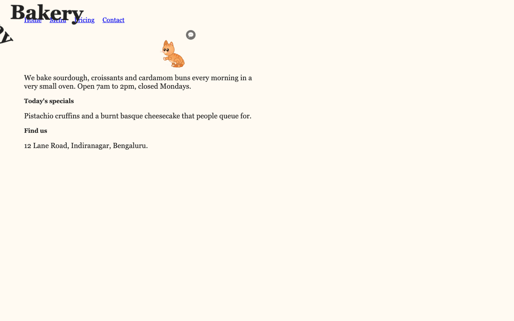
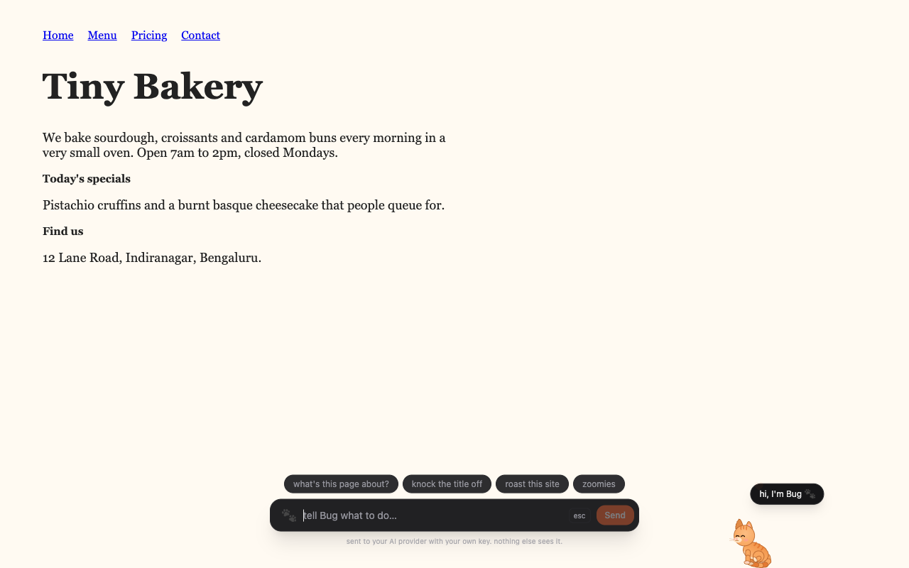
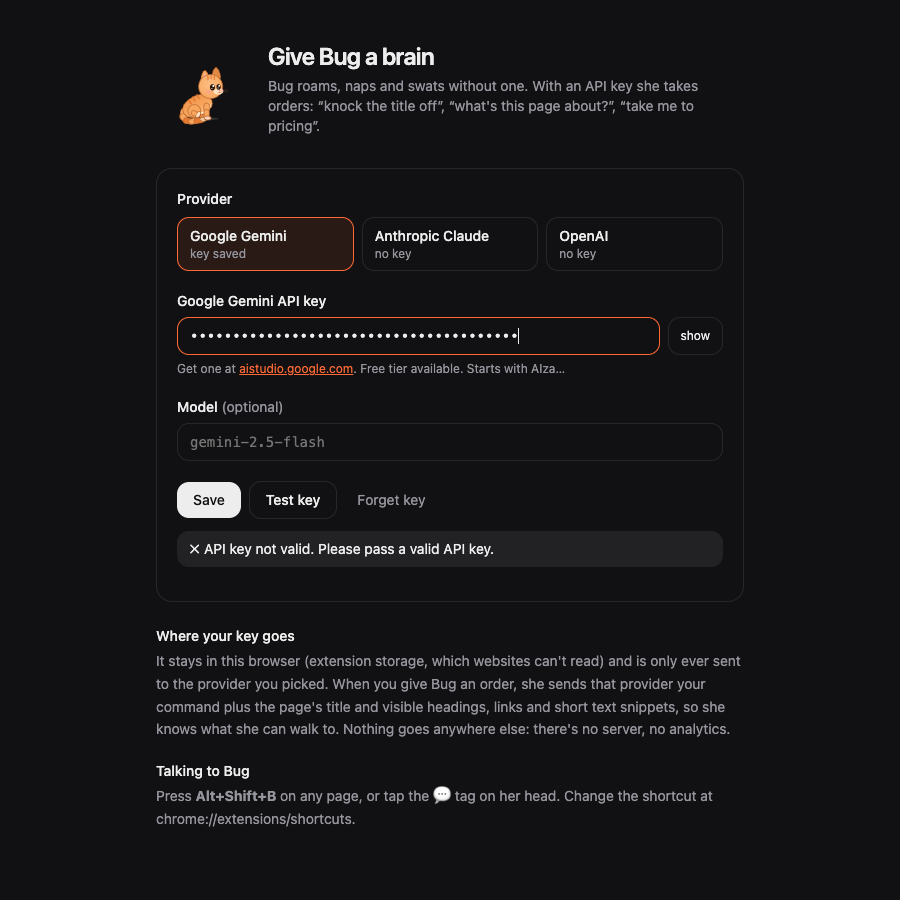
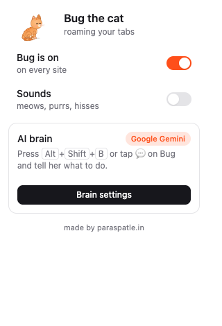

# Bug the cat 🐈

A tiny, sassy orange kitten who lives in your browser. She roams every tab, naps when you're idle, purrs when you pet her, and swats whatever text you select right off the page. Give her an AI key and she takes orders.

She's the same Bug who lives on [paraspatle.in](https://www.paraspatle.in/bug), now free to roam the rest of the internet.



## What she does

- **Roams** the page, follows your cursor when it rests, falls asleep when you're away.
- **Pet her**: click or stroke her for purrs and hearts.
- **Don't grab the tail.** She growls, hisses, claws the screen and stomps off.
- **Select some text** and she runs over and knocks it off the screen like a cup off a table (it comes back).
- **Tell her what to do** (needs an API key): press <kbd>Alt</kbd>+<kbd>Shift</kbd>+<kbd>B</kbd> or tap the 💬 tag on her head. "knock the title off", "what's this page about?", "take me to pricing", "zoomies". An AI plans a few actions from what's on the page and she acts them out.



## Install

Not on the Chrome Web Store (yet), so it's a 30-second manual install:

1. Download `bug-extension.zip` from the [latest release](../../releases/latest) and unzip it.
2. Open `chrome://extensions` and switch on **Developer mode** (top right).
3. Click **Load unpacked** and pick the unzipped folder.
4. The settings page opens: paste an API key if you want Bug to take orders (optional).

Works in Chrome, Edge, Brave, Arc and other Chromium browsers.

## Bring your own AI key

Bug's brain runs on **your** key, with the provider you pick:

| Provider | Default model | Get a key |
| --- | --- | --- |
| Google Gemini (has a free tier) | `gemini-2.5-flash` | [aistudio.google.com/apikey](https://aistudio.google.com/apikey) |
| Anthropic Claude | `claude-haiku-5-5` | [console.anthropic.com](https://console.anthropic.com/settings/keys) |
| OpenAI | `gpt-4o-mini` | [platform.openai.com](https://platform.openai.com/api-keys) |

You can change the model on the settings page. **Test key** makes one tiny request so you know it works.



### Privacy

- Your key is stored in the extension's own storage (`chrome.storage.local`). Websites can't read it.
- Calls to the AI provider happen in the extension's background worker, never in the page.
- When you give Bug an order, the provider gets your command plus the page's title and visible headings, links and short text snippets (so she knows what she can walk to). Nothing is sent anywhere else: no server, no analytics, no tracking.
- Without a key, nothing leaves your browser at all.

## Popup

Click the toolbar icon to turn Bug off everywhere or just on the current site, and to switch sounds on (meows, purrs, hisses; all synthesized, no audio files).

**Sites where Bug stays away:** the settings page has an exclude list (your bank, Google Docs, whatever). A site covers its subdomains too, and you can paste a full URL. [paraspatle.in](https://www.paraspatle.in) is always on it: that's Bug's home, and she already lives there.



## Build from source

```bash
npm install
npm run build      # → dist/ (load it unpacked)
npm run watch      # rebuild on change
npm run zip        # → bug-extension.zip
```

How it fits together:

- `src/content.tsx`: mounts Bug in a shadow root on every page (the page's CSS can't touch her, hers can't touch the page).
- `src/cat/`: the cat itself (React + framer-motion): a rigged SVG puppet, behaviours, falling words, claw marks, synthesized sounds.
- `src/background.ts` + `src/brain.ts`: the AI brain. Builds the prompt, calls Gemini / Claude / OpenAI with structured output, and validates every step (known actions only, real elements only).
- `src/ui/`: popup and settings page.

## License

MIT. Made by [Paras Patle](https://www.paraspatle.in) ([@avgparasite](https://x.com/avgparasite)). Bug also plays poker: [gully poker](https://poker.paraspatle.in/bug).
